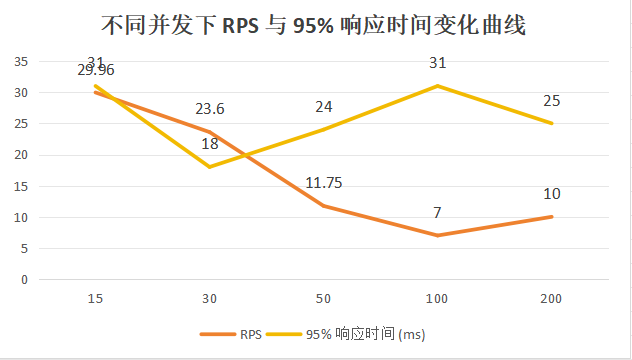

# FastAPI + Locust 接口性能压测项目
基于 Locust 对 FastAPI 接口做并发性能测试
- 压测指标：RPS、95%响应时间、失败率
- 并发梯度：15、30、50、100、200
- 现象：单机Uvicorn单进程在15并发时吞吐量达到峰值，并发升高后RPS逐步下降
- 瓶颈：uvicorn默认单进程，只能使用单个CPU核心，协程调度开销增大
- 优化方案：开启多worker、多实例+负载均衡

